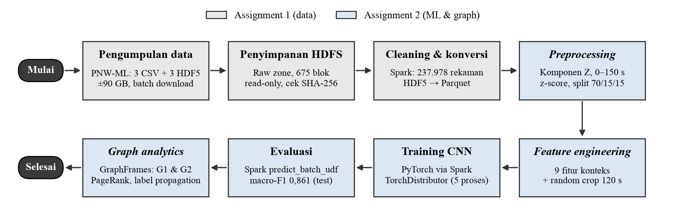
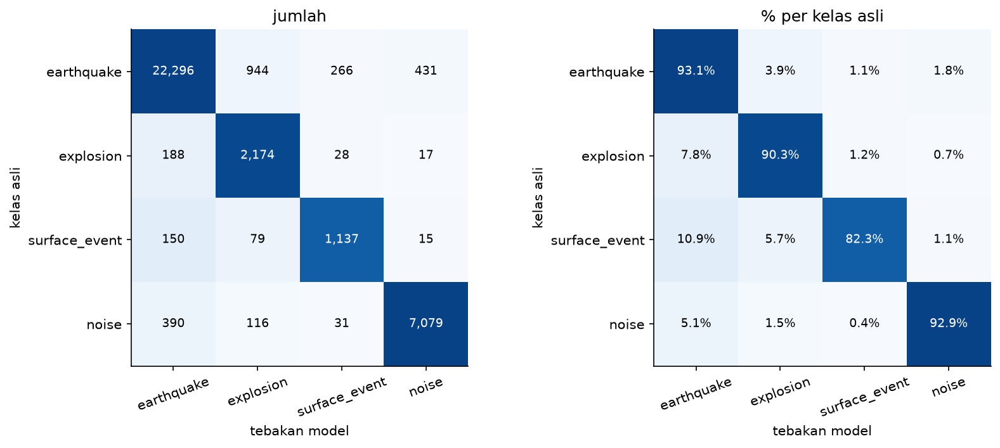
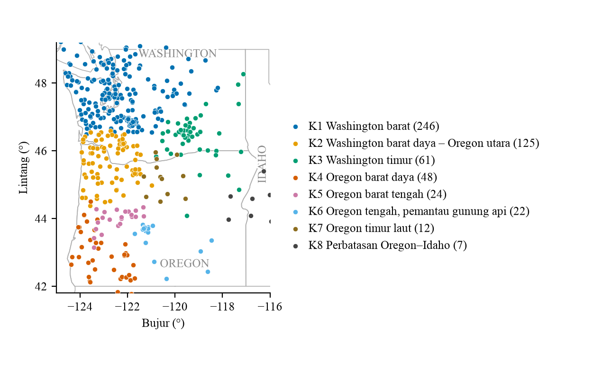

# Rancangan Solusi Big Data untuk Klasifikasi Sinyal Seismik di Wilayah Pacific Northwest

| | |
|---|---|
| Mata kuliah | COMP8035041 Big Data Analytics — Assignment 1 & 2 |
| Program | Master of Computer Science, BINUS Graduate Program (2026) |
| Mahasiswa | Axel Nino Nakata — 2702749701 |
| Dosen | Dr. Devi Fitrianah, S.Kom., M.T.I. · Prof. Spits Warnars Harco Leslie Hendric, S.Kom., M.T.I., Ph.D. |

> **Catatan:** repo ini **tidak berisi dataset** (±90 GB), jadi tidak bisa langsung dijalankan setelah di-clone. Dataset bersifat publik dan bisa melakukan download terlebih dahulu dari sumber aslinya (lihat [Dataset](#dataset)). Semua hasil eksekusi (tabel, gambar, model, log HDFS) sudah tersimpan di `outputs/` dan di output notebook.

## Ringkasan

Sensor seismik merekam semua getaran tanah tanpa tahu sumbernya, sehingga analis Pacific Northwest Seismic Network (PNSN) harus memeriksa setiap kejadian secara manual (*trigger review*). Proyek ini membangun solusi big data *end-to-end* untuk mengotomatiskan klasifikasi tersebut ke empat kelas: **gempa bumi, ledakan, peristiwa permukaan (*surface event*), dan noise**. Dataset PNW-ML (±90 GB, 2002–2022) disimpan di *data lake* **HDFS**, dibersihkan dan dikonversi dengan **Apache Spark**, lalu dipakai melatih **CNN 1D** (PyTorch, dijalankan oleh Spark lewat **TorchDistributor**) yang membaca waveform dan 9 fitur konteks. Model mencapai **macro-F1 0,861** dan **accuracy 0,925** pada data test, jauh di atas baseline (0,202). **Graph analytics** dengan GraphFrames menunjukkan bahwa jaringan stasiun hampir seluruhnya terhubung, 77,7% peristiwa permukaan hanya terekam oleh satu stasiun, dan stasiun membentuk kelompok per wilayah dengan komposisi kejadian yang berbeda. Temuan terakhir ini mendukung keputusan untuk tidak memakai lokasi stasiun sebagai fitur model.

## Alur solusi



| Tahap | Teknologi | Hasil | Notebook |
|---|---|---|---|
| Pengumpulan data | *Batch download* dari server University of Washington | 6 file (3 CSV + 3 HDF5), 90,04 GB | — |
| Penyimpanan | HDFS 3.4.3, *pseudo-distributed*, blok 128 MiB, replikasi 1 | `/datalake/raw` (*read-only*, terverifikasi SHA-256), 675 blok utuh | 01 |
| Tata kelola | `chmod` + ACL per *role*, audit log, lineage | *Engineer* rw, *scientist* r, user lain tanpa akses ke *processed zone* | 06 |
| Cleaning & konversi | Spark 3.5.9 (`local[*]`, 10 core, 12 GB) | 237.978 rekaman bersih; waveform HDF5 → Parquet (71,37 GB) di `/datalake/processed` | 02–05 |
| *Preprocessing* | Spark `mapInPandas`, `xxhash64` | Komponen Z, detik 0–150, *z-score*, split 70/15/15 → 234.467 rekaman (14,07 GB) | 07–08 |
| *Feature engineering* | Fungsi bawaan Spark | 9 fitur konteks (jam/hari/musim sin-cos + jenis sensor *one-hot*) + *random crop* 120 s | 09 |
| Training | PyTorch + Spark TorchDistributor (5 proses, DDP) | CNN dua cabang, 200.868 parameter; model terbaik epoch 9 | 10 |
| Evaluasi | Spark `predict_batch_udf` | Prediksi validation/test di HDFS, metrik, analisis kesalahan | 11 |
| *Graph analytics* | GraphFrames 0.12.3 | Degree, connected components, PageRank, label propagation | 12 |

## Dataset

**PNW-ML** (Ni dkk., 2023) adalah dataset publik hasil kurasi dari ±70 TB rekaman kontinu PNSN periode 2002–2022, dengan label dari analis PNSN.

- Repositori dan link download: <https://github.com/niyiyu/PNW-ML> (lisensi MIT)
- Paper: Y. Ni dkk., "Curated Pacific Northwest AI-ready seismic dataset," *Seismica* 2(1), 2023, [doi:10.26443/seismica.v2i1.368](https://doi.org/10.26443/seismica.v2i1.368)
- File dilakukan download dari `https://dasway.ess.washington.edu/shared/niyiyu/PNW-ML/<nama_file>`. Server ini kadang dibatasi (*rate-limited*), dan mirror Google Drive tercantum di README PNW-ML. URL, ukuran, dan SHA-256 setiap file tercatat di `outputs/hdfs/lineage.jsonl`.

| Bagian | Metadata (CSV) | Waveform (HDF5) | Durasi | Kelas |
|---|---|---|---|---|
| ComCat | 178.939 baris × 37 kolom (50,03 MB) | 187.053 rekaman (67,34 GB) | 150 s | gempa bumi, ledakan |
| Exotic | 9.267 baris × 17 kolom (1,48 MB) | 9.517 rekaman (4,11 GB) | 180 s | peristiwa permukaan |
| Noise | 51.017 baris × 11 kolom (5,03 MB) | 51.462 rekaman (18,53 GB) | 150 s | noise |

Setiap waveform berisi 3 komponen (E, N, Z) dengan 100 sampel per detik. Metadata dan waveform dihubungkan oleh kunci (`dataset`, `trace_name`).

**Ukuran data per tahap:** 90,04 GB mentah → 237.978 rekaman bersih (waveform Parquet 71,37 GB) → 234.467 rekaman siap model (14,07 GB). Cleaning membuang 1.245 baris: label di luar 4 kelas (355), label ComCat yang bertentangan dengan kode PNSN dan tak bisa dipastikan (100), serta noise yang `trace_name`-nya dirujuk ganda (790). Selain itu, 367 label dikoreksi mengikuti kode PNSN.

## Hasil utama

### Klasifikasi (data test, 35.341 rekaman)

| Model | Accuracy | Macro-F1 |
|---|---|---|
| **CNN 1D (waveform Z + 9 fitur konteks)** | **0,925** | **0,861** |
| Baseline (selalu menebak gempa bumi) | 0,677 | 0,202 |

| Kelas | Precision | Recall | F1 |
|---|---|---|---|
| Gempa bumi | 0,968 | 0,931 | 0,950 |
| Ledakan | 0,656 | 0,903 | 0,760 |
| Peristiwa permukaan | 0,778 | 0,823 | 0,800 |
| Noise | 0,939 | 0,930 | 0,934 |



- **Kesalahan terbesar** adalah gempa bumi yang ditebak sebagai ledakan (944 rekaman), karena gempa kecil dan ledakan tambang sama-sama menghasilkan sinyal singkat beramplitudo rendah. *Class weight* membuat model cenderung memilih ledakan saat ragu, sehingga recall ledakan tinggi tetapi precision-nya rendah.
- **Kesalahan berisiko rendah:** hanya 1,7% rekaman kejadian yang ditebak sebagai noise (bisa terlewat). Sebagian besar kesalahan lain tetap terdeteksi sebagai suatu kejadian, sehingga masih bisa dikoreksi analis.
- **Uji keputusan desain:** jika fitur waktu diacak, macro-F1 turun ke 0,786, jadi waveform tetap menjadi sumber utama. Menggeser posisi potongan ±15 s hanya mengubah macro-F1 ≤ 0,007, artinya model membaca bentuk sinyal, bukan posisi kejadian.

### Graph analytics

- **G1 (kejadian–stasiun):** 51.448 kejadian + 642 stasiun, dihubungkan 187.751 edge. Sebanyak 99,99% vertex berada dalam satu *connected component*, jadi jaringan PNSN bekerja sebagai satu kesatuan.
- **Luas rekaman per kelas:** 77,7% peristiwa permukaan hanya terekam oleh 1 stasiun, dibandingkan 17,5% pada gempa bumi. Kejadian seperti ini mudah lolos dari deteksi otomatis yang butuh beberapa stasiun, sehingga klasifikasi per rekaman menjadi penting.
- **G2 (stasiun–stasiun, weight ≥ 5):** 8.637 edge. PageRank menemukan stasiun penghubung antarwilayah yang sentral meski merekam sedikit kejadian.
- **Label propagation** menghasilkan 8 kelompok utama yang berkumpul per wilayah, padahal algoritma tidak menerima lokasi. Komposisinya berbeda per wilayah: ledakan 37–44% di Oregon barat daya dan barat tengah (K4–K5), dan peristiwa permukaan 17,4% di sekitar gunung api Oregon tengah (K6).



## Struktur repo

```
config/hadoop/   konfigurasi HDFS yang dipakai (core-site, hdfs-site, hadoop-env)
src/             kode pipeline: ingest ke HDFS, konversi HDF5→Parquet, preprocessing, CNN, training
notebooks/       01–12, dijalankan berurutan (tabel di bawah)
scripts/         pembuat gambar & angka untuk laporan
outputs/         bukti hasil: tabel, gambar, model (cnn_best.pt), log HDFS — peta isi di outputs/README.md
```

| Notebook | Isi | Bab laporan |
|---|---|---|
| `01_hdfs_smoke_test` | Tes HDFS, WebHDFS, Spark | 2 |
| `02_inspect_data` | Elemen & format data, kamus data | 4.1 |
| `03_cleaning_quality` | Pembersihan metadata, pemeriksaan kualitas | 3.4, 4.1 |
| `04_convert_waveforms` | HDF5 → Parquet, validasi | 2.3, 4.1 |
| `05_data_model` | Model data relasional / array / graf | 4.2 |
| `06_governance` | Hak akses, audit log, lineage | 3 |
| `07_data_audit_ml` | Kondisi data sebelum ML | 4.3, 5.1 |
| `08_preprocessing` | Komponen Z 0–150 s, z-score, split, class weight | 5.1 |
| `09_feature_engineering` | Fitur konteks, input CNN | 5.2 |
| `10_cnn_training` | Arsitektur, training, kurva belajar | 5.3–5.4 |
| `11_evaluation_analysis` | Prediksi dengan Spark, metrik, analisis | 5.5–5.6 |
| `12_graph_analytics` | Graph G1 & G2 dengan GraphFrames | 6 |

## Reproduksi

Untuk menjalankan ulang pipeline, dataset PNW-ML perlu dilakukan download terlebih dahulu dan tersedia ruang disk ±180 GB (raw 90 GB + processed 71 GB + data ML 14 GB). Seluruh eksperimen dijalankan pada macOS (10 core CPU, RAM 24 GB) tanpa GPU.

**Kebutuhan sistem:**
- Java 11
- Hadoop 3.4.3 di `~/opt/hadoop`, dengan konfigurasi dari `config/hadoop/`
- Python 3.11 + paket di `requirements.txt` (PySpark, PyTorch, GraphFrames, h5py, dll.)

Path HDFS dan Spark diatur di `src/common.py`.

```bash
python3.11 -m venv .venv && source .venv/bin/activate && pip install -r requirements.txt
export JAVA_HOME=$(/usr/libexec/java_home -v 11)
hdfs --daemon start namenode && hdfs --daemon start datanode

# 1. Download 6 file PNW-ML ke ~/pnwml-data/staging/downloads/, lalu masukkan ke HDFS (+ cek SHA-256)
src/ingest.sh comcat comcat_waveforms.hdf5          # ulangi untuk keenam file
# 2. jalankan notebook 01–03, lalu konversi waveform
python src/convert_waveforms.py exotic noise comcat
# 3. notebook 04–09, lalu training (±2,5 jam di CPU)
caffeinate -i python src/train_cnn.py
# 4. notebook 10–12
```

Proses training bisa dilakukan monitoring pada `http://127.0.0.1:8765/monitor.html` (lihat `src/train_cnn.py`).

## Referensi utama

Daftar referensi lengkap ada di laporan. Di bawah ini hanya sumber dataset dan studi acuan utama.

- Y. Ni dkk., "Curated Pacific Northwest AI-ready seismic dataset," *Seismica*, vol. 2, no. 1, 2023, doi:10.26443/seismica.v2i1.368.
- Y. Ni, "niyiyu/PNW-ML: PNW-ML seismic dataset," Zenodo, 2023, doi:10.5281/zenodo.7627103 (MIT).
- A. Kharita dkk., "Exploration of machine learning methods to seismic event discrimination in the Pacific Northwest," *Seismica*, vol. 5, no. 1, 2026, doi:10.26443/seismica.v5i1.2068.
